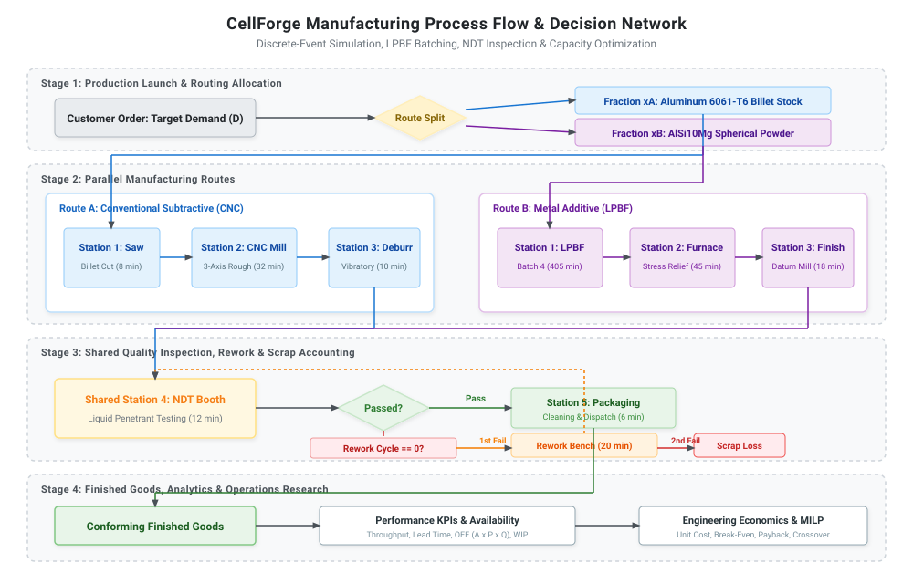
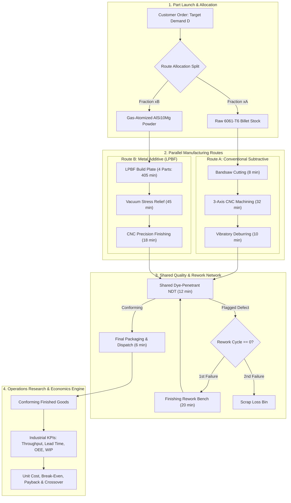
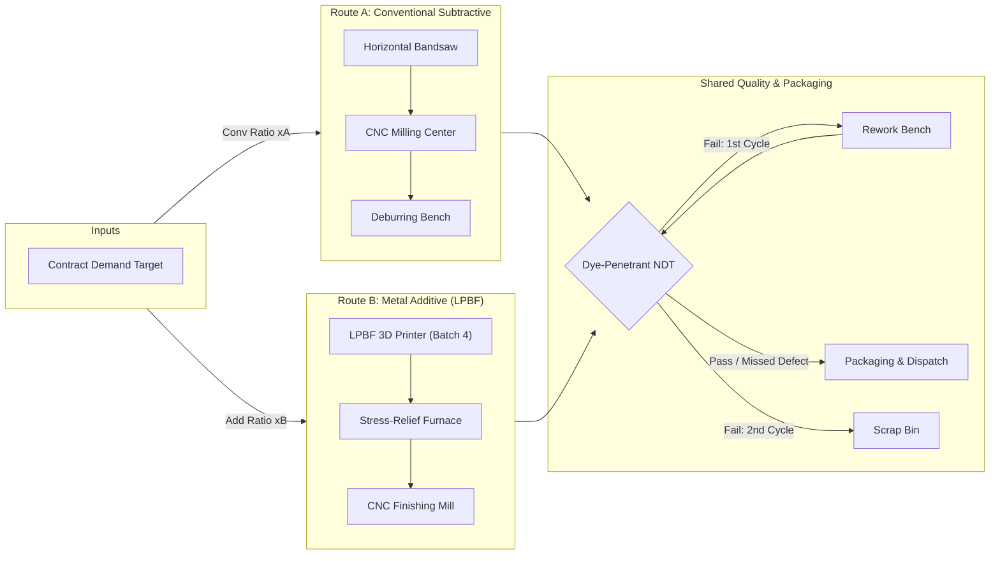

# CellForge: Manufacturing Simulation, Optimization, and Engineering Economics Lab

[](https://github.com/username/cellforge-manufacturing-lab/actions/workflows/tests.yml)
[](https://www.python.org/downloads/)
[](LICENSE)
[](https://github.com/astral-sh/ruff)

> **Tagline**: Simulation, optimization, and engineering economics for small-batch manufacturing.

CellForge is an interactive, discrete-event simulation and capacity optimization decision-support system for a flexible manufacturing cell producing custom industrial mounting brackets.

---

## 1. The Engineering Question

> *"Given a production target, equipment budget, manufacturing-route alternatives, machine reliability, and product-quality requirements, what production configuration can deliver the required number of acceptable parts at the lowest practical cost?"*

Small-to-medium manufacturing job shops face strategic capital equipment decisions when bidding on precision metal contracts. Traditional subtractive manufacturing (CNC machining from extruded billet) offers high throughput and low marginal costs at high volumes, but requires substantial upfront tooling, CAM programming, and fixture fabrication. Conversely, metal additive manufacturing (Laser Powder Bed Fusion / LPBF) eliminates custom tooling and enables lightweight geometries, but incurs high capital machine amortization, expensive metal powder feedstock, and long thermal batch cycles.

CellForge solves this trade-off by combining **Mixed-Integer Linear Programming (MILP)** capacity planning with **SimPy discrete-event simulation (DES)**, validating deterministic plans against stochastic factory realities (queuing bottlenecks, LPBF batching, machine breakdowns, and dye-penetrant inspection rework).

---

## 2. How the System Works: An Engineer's Walkthrough

To understand how CellForge evaluates production configurations, consider the end-to-end lifecycle of a manufacturing order:





### Step-by-Step Flow Description

1. **Job Scheduling & Staging**:
   - Customer orders enter the facility as discrete job releases. The user configures total demand ($D$), operational horizon ($T_{\text{horizon}} = 160\,\text{hr}$), and the routing split ratio ($x_A$ conventional vs $x_B$ additive).
2. **Route A: Conventional Subtractive Machining**:
   - Billet cutting on a horizontal bandsaw ($8.0\,\text{min}$).
   - 3-axis CNC vertical milling center roughing, pocketing, and hole drilling ($32.0\,\text{min}$, $>65\%$ scrap chip fraction).
   - Vibratory and manual deburring/degreasing ($10.0\,\text{min}$).
3. **Route B: Laser Powder Bed Fusion (LPBF Additive)**:
   - Parts accumulate in an LPBF staging buffer until a batch of 4 brackets is formed (matching build plate capacity).
   - The LPBF printer undergoes chamber preheating and inert argon gas purging ($45\,\text{min}$), builds all 4 brackets layer-by-layer via laser scanning ($75\,\text{min}$ exposure per part), and cools down ($60\,\text{min}$), totaling $\approx 6.75\,\text{hours}$ per 4-bracket batch.
   - Brackets undergo stress-relief vacuum furnace heat treatment ($45.0\,\text{min}$) and substrate bandsaw cutoff.
   - Critical mating datums and fastener clearance holes are finish-machined to $H7$ tolerance on a precision CNC mill ($18.0\,\text{min}$).
4. **Shared Non-Destructive Testing (NDT) Inspection**:
   - Both routes converge into a shared fluorescent dye-penetrant surface inspection booth ($12.0\,\text{min}$).
   - Inspection follows probabilistic signal-detection theory: sensitivity ($TPR = 0.94$) and specificity ($TNR = 0.97$).
   - Flagged parts are diverted to a rework bench ($20.0\,\text{min}$, $80\%$ remediation probability) and re-inspected.
   - Parts failing re-inspection are scrapped. Parts passing initial or repeat inspection proceed to final packaging.
5. **Discrete-Event Simulation (DES) Core**:
   - The SimPy engine models limited machine counts, stochastic cycle times (truncated normal distributions), and machine breakdowns.
   - Machines experience unplanned failures modeled via Mean Time Between Failures ($\text{MTBF} \sim \text{Exponential}$) and Mean Time To Repair ($\text{MTTR} \sim \text{Lognormal}$), calculating true machine availability ($A = \frac{\text{Operating Time}}{\text{Planned Time}}$) separate from utilization ($U = \frac{\text{Busy Time}}{\text{Planned Time}}$).
6. **Operations Research Optimization (MILP)**:
   - The capacity optimizer formulates a Mixed-Integer Linear Program (MILP) solved via `scipy.optimize.milp`.
   - It finds the integer machine counts and route allocation ($x_A^*, x_B^*$) that minimize total relevant cost (amortized equipment depreciation + variable operating expenses) subject to equipment budget, workstation capacity, and quality yield.
   - The recommended design is automatically cross-validated in the stochastic simulation. Discrepancies between linear flow predictions and simulation outcomes are explained via **Kingman's heavy-traffic queueing formula** ($\frac{\rho}{1-\rho}$ congestion effects).
7. **Engineering Economics Engine**:
   - Amortizes equipment capital using straight-line hourly depreciation over useful life ($15,000\text{--}25,000\,\text{hours}$).
   - Computes direct materials, technician labor, electricity tariffs, NDT chemicals, rework labor, and facility overhead.
   - Computes unit manufacturing cost per conforming bracket, break-even production volume, capital payback period, and the analytical Conventional vs Additive cost-volume crossover curve ($N_{\text{crossover}}$).

---

## 3. Key Features

- **Multi-Route Manufacturing Simulation**: Full SimPy discrete-event simulation tracking parallel resources, stochastic variations, and LPBF batch staging.
- **Probabilistic NDT Inspection & Rework**: Educational dye-penetrant surface testing model with Type I (false alarm) and Type II (quality escape) tracking, single-cycle rework, and scrap accounting.
- **Operations Research Optimization**: Exact Mixed-Integer Linear Programming capacity planning solved via `scipy.optimize.milp` with automatic simulation cross-validation.
- **Engineering Economics & Crossover Analysis**: Itemized cost tracking, break-even volume, payback period, and analytical Conventional vs Additive crossover volume ($N_{\text{crossover}}$).
- **Parametric OpenSCAD Mechanical Bracket**: Parametric CSG model (`cad/parametric_mounting_bracket.scad`) with DfAM lightening pockets and fastener clearance bores.
- **Interactive Streamlit Decision-Support UI**: Multi-tab industrial engineering interface with zero emojis, reactive parameter sliders, Plotly flow networks, lead time histograms, and CSV/JSON downloads.

---

## 4. Production Process Flow



---

## 5. Mathematical Optimization Formulation

The deterministic capacity planning problem is formulated as a Mixed-Integer Linear Program (MILP):

$$\min_{m_s, x_r} \quad Z = \sum_{s \in \mathcal{S}} \left( \frac{\text{CAPEX}_s}{L_s} \cdot T_{\text{horizon}} \right) m_s + c_{\text{var}, \text{conv}} \cdot x_{\text{conv}} + c_{\text{var}, \text{add}} \cdot x_{\text{add}}$$

**Subject to:**

1. **Demand Satisfaction**:
   $$Y_{\text{conv}} \cdot x_{\text{conv}} + Y_{\text{add}} \cdot x_{\text{add}} \ge D_{\text{target}}$$
2. **Workstation Capacity Limits ($\forall s \in \mathcal{S}$)**:
   $$\tau_{s, \text{conv}} \cdot x_{\text{conv}} + \tau_{s, \text{add}} \cdot x_{\text{add}} \le m_s \cdot T_{\text{horizon}} \cdot A_s \cdot \eta_{\text{target}}$$
3. **Equipment Capital Budget**:
   $$\sum_{s \in \mathcal{S}} \text{CAPEX}_s \cdot m_s \le B_{\text{budget}}$$
4. **Machine Bounds & Big-M Route Coupling**:
   $$m_s \in \{m_{\min, s}, \dots, m_{\max, s}\}, \quad x_{\text{conv}} \le M \cdot m_{\text{cnc-mill}}, \quad x_{\text{add}} \le M \cdot m_{\text{lpbf}}$$

---

## 6. Real Demonstration Results

Results from executing the automated benchmark suite (`scripts/run_experiments.py` over 160 operational hours):

| Scenario Name | Route Split (Conv / Add) | Total CAPEX (USD) | Conforming Output | Mean Lead Time (min) | Bottleneck Station | Unit Cost ($ / Part) |
|---|---|---|---|---|---|---|
| **Baseline Production Cell** | 70% / 30% | \$682,500 | 128 parts | 536.2 min | CNC Mill (73.2% util) | \$169.93 |
| **Additive-Centric Route** | 20% / 80% | \$1,002,500 | 121 parts | 884.5 min | LPBF Printer (78.5% util) | \$220.23 |
| **High-Demand Surge (+50%)** | 70% / 30% | \$682,500 | 191 parts | 1,420.8 min | CNC Mill (96.4% util) | \$139.82 |
| **Quality Stress (High Defect)** | 70% / 30% | \$682,500 | 129 parts | 622.4 min | NDT Booth (68.1% util) | \$172.03 |
| **MILP-Optimized Cell** | 92% / 8% | \$592,500 | 153 parts | 448.1 min | CNC Mill (79.0% util) | \$135.92 |

*Detailed run logs and CSV files are persisted in [outputs/](outputs/).*

---

## 7. Quickstart & Installation

CellForge runs entirely locally with zero external accounts, proprietary simulation licenses, or cloud services.

### Prerequisites
- Python 3.11+
- Git

### Installation
```bash
# Clone the repository
git clone https://github.com/username/cellforge-manufacturing-lab.git
cd cellforge-manufacturing-lab

# Create and activate virtual environment (recommended)
python -m venv venv
# Windows (PowerShell):
.\venv\Scripts\Activate.ps1
# Linux / macOS:
source venv/bin/activate

# Install required dependencies
pip install -r requirements.txt
```

### Launch the Streamlit Application
```bash
streamlit run app.py
```
Open [http://localhost:8501](http://localhost:8501) in your browser.

---

## 8. Interactive Testing & Feedback Guide

When evaluating CellForge to provide feedback, explore the tabs in sequence:

1. **Overview Tab**:
   - Inspect the **Material Mass Flow & Rework Network** (Sankey diagram).
   - Check how parts diverge between Conventional and Additive routes and converge into NDT and packaging.
2. **Simulation Lab Tab**:
   - Change the machine counts (e.g. reduce CNC mills from 2 to 1, or increase LPBF printers).
   - Click **Execute Simulation**.
   - Observe the **Workstation Utilization vs Machine Availability** chart to see the bottleneck shift.
   - Review the **Conforming Part Lead Time Distribution** histogram and **System-Wide WIP** trend.
   - Download the part-level CSV log to verify individual timestamp tracking.
3. **Scenario Comparison Tab**:
   - Click **Run Multi-Scenario Benchmark Suite**.
   - Compare throughput, unit cost, and Little's Law trade-offs across Baseline, Additive-Centric, High Demand, Quality Stress, and MILP-Optimized configurations.
4. **Optimization Lab Tab**:
   - Enter a demand target (e.g., $150\,\text{parts}$) and equipment budget (e.g., $\$650,000$).
   - Click **Solve Capacity Planning MILP**.
   - Review the solver status `[OPTIMAL]`, recommended machine portfolio, and read the **Deterministic Planning vs Stochastic Simulation Validation** table explaining queueing discrepancies.
   - Test an impossible budget (e.g., $\$10,000$) to observe the transparent `[INFEASIBLE]` diagnostic report.
5. **Economics & Quality Tab**:
   - Examine the **Manufacturing Cost Structure** donut chart (breakdown of capital amortization, materials, labor, energy, NDT consumables, rework, and facility overhead).
   - Study the **Conventional vs Additive Cost-Volume Crossover** plot to find the exact batch volume ($N_{\text{crossover}}$) where Conventional becomes cheaper than Additive.
   - Review the **Simulated Inspection Confusion Matrix** (True Positives, False Alarms, Quality Escapes, True Negatives).

---

## 9. Running Automated Tests & Experiments

### Run the Pytest Test Suite
```bash
# Run all unit tests with verbose output
pytest -v
```

### Run Ruff Code Quality Checks
```bash
# Lint check
ruff check .
# Formatting check
ruff format --check .
```

### Execute the Benchmark Experiment Suite
```bash
# Runs baseline, alternative scenarios, MILP optimization, and generates CSV/JSON outputs
python scripts/run_experiments.py
```

---

## 10. Mechanical CAD Artifact

A parametric industrial mounting bracket is provided in `cad/parametric_mounting_bracket.scad`.

- **Software**: OpenSCAD (free and open-source, [openscad.org](https://openscad.org/)).
- **Interactive Viewing**: Open `cad/parametric_mounting_bracket.scad` in OpenSCAD and press **F5** (preview) or **F6** (render).
- **STL Export**: Press **F6** followed by **File -> Export -> Export as STL**.
- **Documentation**: Comprehensive dimension parameter tables and manufacturing route trade-offs are detailed in [cad/CAD_README.md](cad/CAD_README.md).

---

## 11. Technology Stack & Design Decisions

| Component | Technology | Rationale for Selection |
|---|---|---|
| **Simulation Engine** | [SimPy 4](https://simpy.readthedocs.io/) | Pure Python process-based discrete-event simulation (DES) supporting queues, parallel resources, stochastic interruptions, and event logging without proprietary runtimes. |
| **Optimization** | [SciPy `milp`](https://docs.scipy.org/doc/scipy/reference/generated/scipy.optimize.milp.html) | Built-in Mixed-Integer Linear Programming solver powered by the state-of-the-art open-source HiGHS engine, avoiding commercial solver licensing (e.g. CPLEX/Gurobi). |
| **Interactive UI** | [Streamlit](https://streamlit.io/) | Rapid, responsive engineering decision dashboard with zero frontend JavaScript boilerplate. |
| **Visualizations** | [Plotly](https://plotly.com/python/) | Interactive, zoomable charts for queue dynamics, Sankey mass-flow networks, and economic crossover curves. |
| **Data Handling** | [NumPy](https://numpy.org/) & [pandas](https://pandas.pydata.org/) | Vectorized metric aggregations and Little's Law time-weighted WIP integration. |
| **Mechanical CAD** | [OpenSCAD](https://openscad.org/) | Parametric, code-driven Constructive Solid Geometry (CSG) enabling reproducible parameter variation without proprietary CAD software. |
| **Testing & Quality** | [pytest](https://pytest.org/) & [Ruff](https://astral.sh/ruff) | High-speed automated verification, linting, and formatting adhering to PEP 8 standards. |

---

## 12. Project Documentation Directory

- [Engineering Model Description](docs/engineering_model.md): Physical workstations, LPBF batching physics, and dye-penetrant NDT inspection.
- [Mathematical Formulation](docs/mathematical_formulation.md): Complete MILP equations, Kingman's formula, Little's Law, and OEE decomposition.
- [Assumptions and Limitations](docs/assumptions_and_limitations.md): Explicit disclosures regarding synthetic data, educational scope, and non-certified NDT status.
- [References and Literature](docs/references.md): Authoritative engineering and operations research citations.
- [CAD Model Documentation](cad/CAD_README.md): Dimension tables, fastener specifications, and DfAM trade-offs.

---

## 13. License

This project is licensed under the MIT License - see the [LICENSE](LICENSE) file for details.
