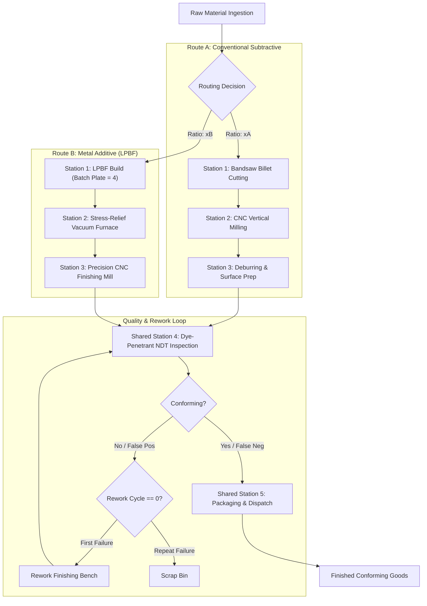

# CellForge: Manufacturing Engineering Model

## 1. System Overview

CellForge models a flexible, small-batch manufacturing production cell producing custom industrial mounting brackets. The facility contrasts two competing manufacturing paradigms:

- **Route A: Conventional Subtractive Manufacturing (CNC Machining)**
- **Route B: Laser Powder Bed Fusion (LPBF Metal Additive Manufacturing)**

Both routes converge into a shared Quality Control inspection station using Non-Destructive Testing (NDT), followed by final packaging and dispatch.

---

## 2. Process Descriptions

### Route A: Conventional Subtractive Manufacturing
1. **Raw Material Cutting (`saw`)**:
   - Machine: Heavy-duty horizontal mitering bandsaw ($4.5\,\text{kW}$).
   - Material: Extruded rectangular bar stock of Aluminum 6061-T6 ($85 \times 65 \times 75\,\text{mm}$).
   - Operation: Cutting individual billet blocks from $3\,\text{m}$ extruded bars. Mean duration: $8.0\,\text{min}$ ($\sigma = 1.2\,\text{min}$).
2. **CNC Rough & Semi-Finish Machining (`cnc_mill`)**:
   - Machine: 3-Axis Vertical Machining Center ($18.0\,\text{kW}$, $12,000\,\text{RPM}$ spindle).
   - Tooling: $16\,\text{mm}$ carbide roughing end mill, $10\,\text{mm}$ flat finisher, $6.6\,\text{mm}$ and $9.0\,\text{mm}$ carbide drills.
   - Operations: Facing, pocket roughing, profile contouring, and drilling base/flange clearance holes across two setups in soft jaws.
   - Cycle time: $32.0\,\text{min}$ ($\sigma = 3.5\,\text{min}$). High chip generation (>65% billet mass converted to chips).
3. **Deburring & Surface Preparation (`deburr`)**:
   - Equipment: Vibratory finishing bowl and manual pneumatic deburring bench ($2.5\,\text{kW}$).
   - Operations: Edge chamfering, removing burrs from drilled hole breakouts, degreasing, and ultrasonic washing.
   - Cycle time: $10.0\,\text{min}$ ($\sigma = 1.5\,\text{min}$).

### Route B: Metal Additive Manufacturing (LPBF)
1. **Laser Powder Bed Fusion (`lpbf`)**:
   - Machine: Industrial LPBF system ($7.5\,\text{kW}$, $400\,\text{W}$ Yb-fiber laser, $250 \times 250 \times 325\,\text{mm}$ build envelope).
   - Feedstock: Gas-atomized spherical AlSi10Mg aluminum alloy powder ($20\text{--}63\,\mu\text{m}$).
   - **Batching Physics**: Up to 4 brackets are nested on a common aluminum build plate. The process consists of:
     - Fixed chamber pre-heating and argon gas purging: $45\,\text{min}$.
     - Laser exposure and layer recoating ($30\,\mu\text{m}$ layer height): $75\,\text{min}$ per bracket.
     - Controlled chamber cool-down: $60\,\text{min}$.
     - Total batch duration for a full plate of 4 brackets:
       $$T_{\text{batch}} = 45 + (4 \times 75) + 60 = 405\,\text{min} \approx 6.75\,\text{hours}$$
2. **Support Removal & Stress-Relief Heat Treatment (`post_heat`)**:
   - Equipment: Inert-atmosphere vacuum resistance furnace ($12.0\,\text{kW}$) and wire bandsaw.
   - Operations: Heat treatment cycle at $300^\circ\text{C}$ for 2 hours to relieve residual thermal stresses induced by rapid laser melting, followed by mechanical support structure cutoff.
   - Cycle time: $45.0\,\text{min}$ ($\sigma = 5.0\,\text{min}$) per part.
3. **Precision CNC Finishing (`cnc_finish`)**:
   - Machine: 3-Axis Precision High-Speed CNC Mill ($14.0\,\text{kW}$).
   - Operations: Additive parts have near-net shape but high as-built surface roughness ($Ra \approx 12\,\mu\text{m}$). This station performs light skimming of critical mounting datums and precision reaming of M6 and M8 bores to achieve $H7$ tolerance.
   - Cycle time: $18.0\,\text{min}$ ($\sigma = 2.0\,\text{min}$).

---

## 3. Shared Quality Control & NDT Model

Both routes route parts to a shared inspection station modeling **Liquid Penetrant Testing (PT / FPI)**.

### Probabilistic Inspection Framework
Surface inspection in non-destructive testing is governed by signal detection theory:

- **Defect Prevalence ($p_{\text{def}}$)**:
  - Route A: $3.5\%$ (tool wear tears, dimensional chatter, clamping deflection).
  - Route B: $7.5\%$ (lack of fusion porosity, recoater blade gouges, residual stress microcracks).
- **Inspection Sensitivity (True Positive Rate, $TPR$)**:
  $$TPR = P(\text{Flagged} \mid \text{Defective}) = 0.94$$
- **Inspection Specificity (True Negative Rate, $TNR$)**:
  $$TNR = P(\text{Accepted} \mid \text{Conforming}) = 0.97$$
  *False Positive Rate (Type I error)*: $FPR = 1.0 - TNR = 0.03$ (3.0% false indication rate).
- **Quality Escapes (Type II error)**: $FNR = 1.0 - TPR = 0.06$ (6.0% probability that a physical defect escapes undetected).

### Rework Policy
- Parts flagged as non-conforming by inspection are diverted to a dedicated rework bench if `rework_count == 0`.
- Rework bench duration: Mean $20.0\,\text{min}$ ($\sigma = 3.0\,\text{min}$).
- Remediable defects (e.g. minor burrs, high spots, superficial porosity) are cleared with probability $p_{\text{succ}} = 0.80$.
- After rework, parts are returned to the shared inspection station for **mandatory re-inspection**.
- Parts failing re-inspection, or parts flagged twice, are discarded to scrap.

---

## 4. Machine Reliability & Maintainability

Workstations experience stochastic unscheduled downtime modeled via:
- **Time to Failure ($TTF$)**: Exponential distribution with mean $\text{MTBF}$:
  $$f_{\text{TTF}}(t) = \frac{1}{\text{MTBF}} e^{-t / \text{MTBF}}$$
- **Time to Repair ($TTR$)**: Lognormal distribution with mean $\text{MTTR}$:
  $$f_{\text{TTR}}(t) = \frac{1}{t \sigma \sqrt{2\pi}} \exp\left( -\frac{(\ln t - \mu)^2}{2\sigma^2} \right)$$
- During a repair event, 1 machine instance is offline, queueing upstream parts and logging downtime minutes.
